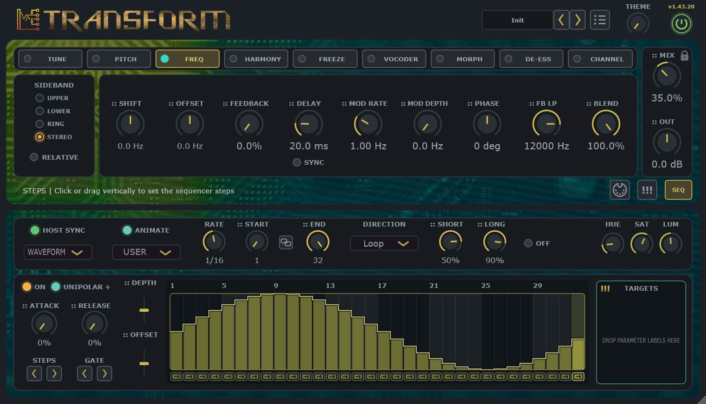
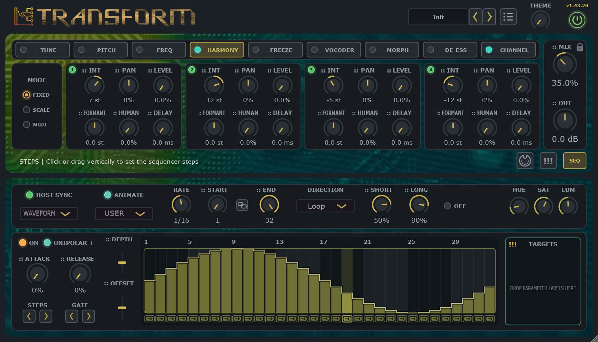

# Transform

# Introduction

**Transform** is a Windows x64 VST3 pitch, voice and creative sound manipulation project by Dead Channel Audio. Its nine independently switchable modules share a contextual editor, MIX/OUT controls and a complete 32-step sequencer. TUNE provides monophonic pitch detection, a chromatic tuner and scale-based pitch correction.

PITCH provides seven source-optimised and creative pitch modes (Chords, Vocal, Granular, Bass, Beats, Textures and Alternator), with independent formant shifting in Chords mode. HARMONY adds up to four parallel interval voices. FREQ provides stereo frequency shifting, modulation, tempo-synced filtered feedback and ring modulation.

FREEZE captures audio for granular playback, pitched micro-loop synthesis and audio-driven shaker percussion. MORPH resynthesises monophonic input using pitch-tracked harmonics and a sub-octave layer. VOCODER transfers the spectral envelope of the input onto an internal MIDI synth, noise or external carrier.

DE-ESS reduces sibilance; CHANNEL provides a gate, adjustable compressor, low cut, simple tonal EQ and soft saturation.

Credits: Many thanks to Artvera for the logo.

## Requirements

- Windows x64
- A 64-bit VST3 host
- A writable VST3 folder if Transform's portable settings, presets and sequences are to remain beside the plugin

## Interface

Use the current development build with a fresh plugin instance when testing.

- **Logo:** click to open the GUI Zoom menu and choose a GUI zoom from 75% to 300%, in 25% increments. The window can also be resized using its corner. The selected zoom is saved in Settings.ini.
- **Module tabs:** click TUNE, PITCH, FREQ, HARMONY, FREEZE, VOCODER, MORPH, DE-ESS or CHANNEL to edit that module. The aqua LED inside each tab independently enables or bypasses the module; multiple modules may be enabled at once. All start disabled. Power states are saved and host-automatable; selecting a tab does not change any power state.

  Each plugin instance remembers its selected tab when the editor is closed and reopened; the tab is also stored in host state, independently of sound presets.

- **Module editor:** TUNE displays the live tuner and correction controls, PITCH displays its transposition controls, HARMONY displays all four voices simultaneously, FREQ displays all eleven frequency-shifting controls, FREEZE displays twelve capture/playback knobs and algorithm, voice, mode and direction selectors, MORPH displays its nine resynthesis knobs and mode selector, VOCODER displays sixteen compact effect knobs, a BANDS rotary and the CARRIER radio selector, DE-ESS displays its seven rotary controls, two radio selectors and gain-reduction meter, and CHANNEL displays twelve dynamics and tone controls in two panels, with a compressor gain-reduction meter.

  Selected tabs are gold; unselected tabs are grey, independently of the aqua LEDs.

### TUNE

Enable its LED and play or sing one note. The display shows the nearest equal-tempered input note, detected frequency, deviation and selected target. REFERENCE (400–480 Hz, default 440 Hz) adjusts A4. Green indicates within three cents; gold indicates sharp or flat. The detector analyses the original input and chooses the louder stereo channel; approximate range 35–1600 Hz.

Silence and unclear pitch leave the meter blank. The stepped KEY knob selects the root for nine standard scales. The tuner and centred SCALE dropdown occupy the left panel; six knobs and twelve custom note buttons occupy the right panel.

SCALE also offers Custom (choose any combination of the twelve absolute note buttons; all initially enabled, no target when all are off) and MIDI (nearest held MIDI note, within ±24 semitones; no held eligible note means no correction). Custom and MIDI ignore KEY. AMOUNT (0–100%, default 0%) sets correction strength. SPEED (0–200 ms, default 40 ms) sets the correction smoothing time.

TOLERANCE (0–100 ct, default 0) leaves a deadband around the target; outside it, only the deviation beyond the deadband is corrected. VIBRATO (0–100%, default 0) blends instantaneous correction with a 180 ms smoothed correction error to retain faster pitch variation while correcting slow drift. This is an approximation and resets at target-note changes. For correction, set MIX to 100% and raise AMOUNT.

MIDI notes are shared with other MIDI-enabled modules; there is no separate channel routing or sustain pedal support. MIDI pitch correction at large intervals inherits spectral level and transient artifacts. No extra reported latency. The analysis window is approximately 65 ms and updates about every 25 ms.

### PITCH

Enable its LED, select the tab and adjust PITCH (-24 to +24 semitones), FINE (-100 to +100 cents) and FORMANT (-24 to +24 semitones, default 0). FORMANT moves the broad spectral envelope relative to the transposed sound, without shifting the musical notes; positive values brighten/raise resonances and negative values lower them.

PRESERVE (0–100%, default 0) counteracts resonance movement from the combined TUNE/PITCH transposition; FORMANT remains an independent relative offset. GLIDE (0–500 ms, default 0) smooths changes in manual PITCH and FINE, including returning to zero. The time indicates approximately 99% of the transition in musical pitch; zero updates on the next spectral frame. GLIDE does not affect a steady pitch setting.

DETUNE (0–100 ct, default 0) spreads the stereo lead pitch by half the selected interval on each side and is ignored in mono. TRANSIENT (0–100%, default 0) progressively lowers the spectral-flux threshold for reseeding phases at attacks in Chords; in Beats it increases the short original-attack overlay. The PITCH controls are active only when PITCH is enabled.

Select one of the seven amber ALGORITHM radio LEDs in the separate left panel. Chords is the default PITCH algorithm and uses phase-locked spectral processing. Vocal uses detected-period-aligned time-domain grains for monophonic material, passes unvoiced sections through, and falls back to waveform-aligned granular processing when a voiced period will not fit the available history.

Granular uses overlapping, waveform-aligned resampled grains without pitch detection. Textures uses longer grains, four-way overlap and a smoother squared-parabolic window for a more diffuse character. Bass uses a longer analysis window with a nominal 20–500 Hz detector range and longer period-adaptive, waveform-matched grains to stabilise low notes.

Beats uses short overlapping grains and stereo-linked transient detection; it preserves a brief portion of the original attack at the detected onset, then returns to the transposed signal. FORMANT and PRESERVE are Chords-only because they rely on the spectral envelope of the FFT engine. TRANSIENT is available in Chords and Beats, which have transient-aware processing.

Unsupported controls are dimmed rather than silently ignored. GLIDE, DETUNE, FEEDBACK and BLEND apply to all seven. TUNE and HARMONY retain spectral processing when used independently. These are lead-stage enhancements; existing parallel harmony voices retain their original processing. This is a spectral approximation, not a dedicated vocal-tract model. Set MIX to 100% to hear the shifted signal alone.

The spectral engine processes single notes and chords without changing playback duration. With both TUNE correction and PITCH neutral or disabled, audio passes unchanged after latency compensation. BLEND (0–100%, default 100%) mixes this module independently of the master MIX; at zero, TUNE correction remains audible if enabled.

With PITCH alone enabled, set both BLEND and master MIX to 100% for shifted-only audio; master MIX defaults to 35% and otherwise reintroduces the original audio. FEEDBACK (0–95%, default 0%) sends the transformed lead through a separate pitch-shifting loop, adding the manual interval on each repeat (approximately one FFT frame of delay per repeat). At zero pitch this is a short delay.

Feedback is bounded internally and high settings can be loud; lower OUT as needed. Formant preservation and transient phase reset are approximations. Vocal is a first-stage pitch-synchronous shifter, not a formant-preserving vocal-tract model. Unvoiced input may remain audible at full BLEND in Vocal mode. Mode switching during playback can produce transition artifacts; choose the mode before playback for critical use.

Alternator uses consecutive grains transposed in opposite directions around the tuning correction; try PITCH +7 or +12 st on a sustained note. FORMANT, PRESERVE and TRANSIENT are not available in this mode.

### HARMONY

Enable its module LED, enable the numbered LED for each desired voice and raise its LEVEL (0–100%). Voice LEDs start on, retain their level when muted, and are saved and host-automatable. The five separate panels contain a MODE radio selector and four voice groups.

MODE selects Fixed (chromatic INT, ±24 st), Scale (nearest permitted TUNE scale note to the requested interval) or MIDI (the first four held notes in ascending order assigned to voices 1–4). Scale uses the configured TUNE key, scale, custom notes and reference even if TUNE correction is off; if TUNE SCALE is MIDI, Scale harmony uses the chromatic scale.

Scale and MIDI modes require reliable monophonic input pitch and mute voices without eligible targets within ±24 st of the configured lead. MIDI ignores INT. PAN (±100%) balances stereo, FORMANT (±24 st) offsets each voice’s spectral resonances relative to the lead, HUMAN (0–100%) adds voice-specific fixed detuning (up to 18 ct) and timing offsets (up to 13 ms), and DELAY (0–100 ms) independently delays the voice.

The four default intervals are +7, +12, −5 and −12 st. All levels default to zero; the lead remains present. Voices follow configured lead transposition and tuning correction. Reduce OUT as necessary when layering voices. Humanisation is deterministic, not random modulation; it can intentionally detune scale or MIDI targets.

### FREQ

Enable its LED and adjust SHIFT (-2000 to +2000 Hz). Unlike PITCH, this adds a fixed frequency offset rather than a musical interval. OFFSET (-1000 to +1000 Hz) sets the signed difference between the right and left shifts, centred on SHIFT; in mono it is ignored.

The separate SIDEBAND radio panel selects Upper (add the signed shift), Lower (subtract it), Ring (both sidebands) or Stereo (lower shift on the left, upper on the right; mono uses the lower sideband). In Stereo, OFFSET adjusts the carrier offsets before selecting opposite sidebands. FEEDBACK (0–95%) recirculates the shifted signal after DELAY (1–100 ms, default 20 ms) in Free mode.

The green SYNC LED switches DELAY between free milliseconds and eight host-tempo subdivisions from a quarter to a thirty-second note, including dotted and triplet choices (D and T). Each mode retains its own setting. If host tempo is unavailable, 120 BPM is used. MOD RATE (0.05–20 Hz, default 1 Hz) sets the speed of the sinusoidal shift modulation; MOD DEPTH (0–1000 Hz, default 0) sets its excursion.

PHASE (±180 deg, default 0) offsets the right carrier phase and is ignored in mono. FB LP (100–20000 Hz, default 12000 Hz) low-pass filters the feedback loop only. BLEND (0–100%, default 100%) mixes only this module. SHIFT, OFFSET, FEEDBACK, MOD DEPTH and PHASE default to zero, so the module remains transparent until adjusted. SYNC is centred beneath the DELAY readout. RELATIVE remains in the SIDEBAND panel.

RELATIVE switches SHIFT to a separate ±200% control relative to the detected monophonic fundamental (100% adds one fundamental in Upper mode). Without a reliable detected pitch, the relative shift falls to zero. OFFSET and modulation remain in Hz.

### FREEZE

Enable the module, set master MIX and FREEZE BLEND to 100% for wet-only testing. The separate left selector panel uses amber MODE and DIRECTION radio LEDs. Live continuously processes the rolling audio history as pitched or reversed grains, without holding a fixed snapshot. Hold sustains the latest usable capture: play audio in Live first, then select Hold at the desired moment.

If enabled directly in Hold it waits for usable input rather than freezing silence. Return to Live to record a new passage. MIDI records until the first held note requests a capture, waits for usable audio if needed, then retains that capture for subsequent notes and chords (up to eight voices).

With full BLEND the output is silent when no notes are held; lower BLEND to hear the source alongside the triggered playback. MIDI note 60 is the untransposed root; note offsets plus PITCH are limited to ±24 st. Switch back to Live to acquire new audio.

CAPTURE (100–8000 ms, default 2000) selects the newest portion of the available history; SIZE (20–500 ms) controls grain duration, POSITION (0–100%) scans from newest to oldest, DENSITY (2–8 gr) sets overlapping grains per voice, SMOOTH (0–100%) adjusts the grain crossfade shape and DRIFT (0–100%) varies successive grain positions. DIRECTION selects Forward or Reverse. BLEND (0–100%) mixes the module with its input.

Short captures and large pitch shifts may restrict effective grain length. Captures omit initial and trailing near-silence; internal quiet regions may still be selected by POSITION. Captured audio is temporary and not saved in presets. Changes to grain parameters take effect as grains are generated. Very quiet sources may need more input level to trigger acquisition, and multiple MIDI voices can increase output gain.

### MORPH

Enable its LED, play a single sustained note or vocal, and raise BLEND (0–100%, default 0). HARMONICS (0–100%, default 50) sets the strength of partials above the tracked fundamental; TIMBRE (0–100%, default 50) balances even harmonics at 0 and odd harmonics at 100. SUB (0–100%, default 0) adds a synthetic octave below the tracked note.

RESPONSE (5–200 ms, default 30) adjusts envelope release, with a fixed 4 ms attack. DENSITY (1–16, default 6) selects the total partial count, including the fundamental. SMEAR (0–100%, default 0) blends slightly detuned upper partials to spread the spectrum. MOD RATE (0.05–20 Hz, default 1) and MOD DEPTH (0–100%, default 0) apply sinusoidal timbre modulation.

The MODE radio panel selects Additive (harmonic partials), Reed (odd-partial emphasis) or Metallic (inharmonic partials). BLEND mixes the resynthesised signal with this module’s input. Set global MIX to 100% to audition the module alone. Unpitched input fades the synthetic output to silence; BLEND alone determines the dry contribution. At 100% BLEND no original audio is mixed in after the enable fade.

Allow approximately 65 ms for initial pitch detection. The result is an envelope-following synthetic texture, not natural vocal correction.

### VOCODER

Enable its LED, raise BLEND (0–100%, default 0) and send speech or other audio to Transform’s main input (modulator). CARRIER uses amber radio LEDs to select Saw or Pulse (up to eight MIDI voices), Noise (no MIDI required) or Sidechain (route another track to the optional carrier bus). Use the stepped BANDS rotary to choose 8, 12, 16, 24, 32 or 48 (default 24).

BANDWIDTH (50–200%, default 100) changes the analysis and carrier filter widths, with approximate overlap gain compensation. DETUNE (0–100 ct, default 0) spreads the internal Saw/Pulse carrier oscillators by half the selected interval on each side; it is inactive in Noise and Sidechain. UNVOICED (0–100%, default 65) preserves input consonants according to a high-to-full-band envelope detector and carrier activity.

ATTACK (1–100 ms, default 5) and RELEASE (10–500 ms, default 45) set the envelope response. FORMANT (±12 semitones, default 0) shifts the band envelope, WIDTH (0–100%, default 100) adjusts the wet stereo width, and NOISE (0–100%, default 0) adds high-frequency noise following the upper modulator bands for consonant clarity.

SHIFT (±12 st, default 0) retunes the filter bank, with its upper edge limited by the sample rate; CONTOUR (±12 dB, default 0) tilts band levels from dark to bright. COMPAND (0–100%, default 0) applies parallel compression to the modulator. MOD IN and CAR IN (±24 dB, default 0) adjust the modulator and carrier input levels.

Input peaks above unity are gently compressed for headroom, and stereo-linked wet gain protection reduces excessive output peaks before the MIDI note gate and master OUT. High master gain or downstream effects can still overload the output. HARMONIC (0–100%, default 0) enriches the carrier, and SUB (0–100%, default 0) adds a pulse oscillator one octave below the internal Saw/Pulse carrier.

SUB is inactive in Noise and Sidechain. With Saw or Pulse, send MIDI notes to the effect while audio plays; with no notes, the complete wet output, including NOISE and UNVOICED, is silent after a short 35 ms note gate release aligned to the carrier latency. Noise carrier does not require MIDI. Saw and Pulse use bounded per-band carrier equalisation to improve speech-envelope transfer.

With Sidechain, an unavailable bus falls back to dry, but a connected silent carrier produces silence at 100% wet.

### DE-ESS

Enable the module, set RANGE above zero (0–24 dB), and adjust FREQ (2–12 kHz), THRESHOLD (−60 to 0 dB), ATTACK (0.1–20 ms) and RELEASE (10–500 ms). BANDWIDTH (25–200%, default 100%) adjusts the unity-centre-gain detection filter width; lower values focus on a narrower frequency region.

ADAPTIVE (0–100%, default 0%) progressively raises the absolute threshold relative to the complementary vocal-body envelope, helping avoid excess attenuation on strong vowels. It is a relative-level detector, not automatic identification of the sibilance frequency.

The left radio panel selects MODE: Split-band (subtract the selected band) or Broadband (reduce the entire signal), and MONITOR: Normal or Removed to audition the attenuated signal. The Gain Reduction meter below the knobs displays the peak attenuation of the selected reduction path with a 250 ms decay. RANGE defaults to zero. Detection is stereo-linked; no additional reported latency.

### CHANNEL

GATE (-80 to -20 dB, minimum disables), COMP (0–100%, compression amount), THRESH (-60 to 0 dB), RATIO (1:1–20:1), ATTACK (0.1–100 ms), RELEASE (10–1000 ms), LOW CUT (0–300 Hz, zero disables), LOW/MID/HIGH and PRESENCE (all ±24 dB), SAT (0–100%, post-EQ soft saturation). COMP defaults to zero; its threshold, ratio, attack and release default to -42 dB, 8:1, 3 ms and 100 ms.

COMP applies automatic makeup gain scaled with the selected ratio. Gain Reduction indicates compressor attenuation before makeup, gate/EQ/saturation and master MIX; display is capped at 48 dB. Enable the module and adjust only the controls needed. Large boosts and saturation can produce output above full scale; reduce OUT as needed.

- **MIX / OUT:** blend the dry and processed signals and adjust output level. The Mix Lock preserves the Mix setting when loading presets.
- **THEME:** 0% shows the optional background artwork, 50% is plain charcoal and 100% is dark petrol green (RGB 12, 67, 70). The colour bar fades in from transparent at 0% to fully opaque at 50%, then stays opaque. Double-click or middle-click to reset to 50%; the setting is saved in Settings.ini.
- **Power:** enable or bypass processing.
- **Preset browser:** browse folders, favourites, save, copy/paste, and step through presets.
- **Randomise (!!!):** generate new settings for the selected module’s visible, applicable rotary controls. Power, modes, inactive voices, master MIX/OUT, theme, sequencer, MIDI assignments, input gains, tuning reference and noise gate are unchanged. Feedback, voice levels, EQ boosts and wet blend use moderated random ranges.

  This changes live parameter values, not the saved preset; use left double-click to restore individual saved values, or reload the preset to restore them all.

- **SEQ:** show or hide the sequencer without changing its zoom or settings.

DE-ESS uses a stereo-linked, adjustable-width band detector with optional body-relative threshold adaptation and complementary band subtraction or broadband gain control, with no additional FFT or latency. The Gain Reduction meter measures the internal attenuation, before downstream modules and master MIX; in Split-band mode it is not the reduction of the entire signal.

Its removed-signal monitor is routed through subsequent enabled modules; bypass those modules for isolated auditioning. The provisional serial order is DE-ESS → TUNE → PITCH → HARMONY → FREEZE → MORPH → VOCODER → FREQ → CHANNEL. TUNE analyses the original input. At full PITCH BLEND, correction and manual transposition share the selected lead engine.

At partial BLEND, a parallel correction-only reference is used when correction is active, so BLEND never removes tuning. At zero BLEND only the correction reference is audible. Both paths use the same fixed delay; the unused FFT sleeps after its transition. FEEDBACK uses a separate instance of the selected pitch engine only when needed and reapplies the manual interval, not the input tuning correction.

The feedback signal is bounded to limit runaway gain. PITCH BLEND does not control the independent HARMONY module; harmony voices continue to follow the configured lead intervals. The PITCH latency is fixed across algorithms. The spectral FFT uses a fixed frame size chosen at prepare time (2048 samples at 44.1/48 kHz, 4096 at 96 kHz, 8192 at 192 kHz).

The plugin reports that latency to the host, and both dry and wet paths retain the same fixed delay even with PITCH disabled or the master bypassed. This avoids changes to host latency while automating PITCH; FFT processing stops when neither correction nor PITCH requires it, after a brief transition. FORMANT and PRESERVE reuse the FFT and estimate a spectral envelope only when a non-unity envelope shift is required.

Correction is monophonic. Spectral processing can affect vocal timbre and transients; the lead-stage PRESERVE and TRANSIENT controls provide approximate compensation. Host delay compensation aligns playback, but live monitoring incurs approximately 43–46 ms of latency at these rates.

HARMONY processes parallel copies of the pre-PITCH signal, applying the lead offsets plus each voice interval with the same FFT frame size and no extra reported latency. Spectral lead and harmony processing use peak-region phase locking. Time-domain modes use the same nominal delay, with bounded grain-position variation, and a precomputed 24-tap low-pass resampling table for upward shifts.

Vocal and Bass pitch detection take time to acquire a note; they can miss short or polyphonic notes. Bass analysis needs approximately 100 ms initially, and can fall back to waveform matching when pitch is unclear. Beats deliberately retains some unshifted attack content; it may sound less natural on sustained tones. Each audible voice has its own spectral engine, so CPU cost increases with active voices.

Voices fade in after their initial frame and fade out when muted; muted voices skip FFT processing. Actual latency compensation and CPU cost should be checked in the host. FREQ uses a six-section quadrature allpass pair per channel and a rotating oscillator, not an FFT.

It adds no fixed reported latency, but the active allpass filters alter phase and signals close to DC or Nyquist can have imperfect sideband rejection or aliasing. A short wet fade smooths enable/disable; the engine sleeps when disabled or neutral and its fade completes. Feedback is limited to 95% and the recirculating signal is bounded and low-pass filtered.

Its delay history is preallocated for up to six seconds (quarter note at 10 BPM); bypass invalidates old samples without clearing the buffer on the audio thread. High settings can produce loud and prolonged repeats; reduce OUT when needed. The host tail estimate is at least 15 seconds and increases according to the current FREQ feedback and delay, approximating decay to -60 dB. Hosts may cache the estimate.

Delay/tempo changes are smoothed but can create pitch sweeps. FREEZE captures the signal after HARMONY, using a shared preallocated eight-second stereo ring buffer and up to eight grain streams with two to eight overlapping grains per voice. Grain starts are locally waveform-aligned, with optional position drift. No extra fixed latency or FFT; the capture is a view of recorded history rather than a copied buffer.

CPU increases with voice count, density and shorter grains. Grain size, pitch and direction apply to new grains; capture length selects the newest available region. Fully muted playback retains the snapshot and suspends grain reads. Upward resampling can alias; extreme automation and short captures may produce granular artifacts.

MIDI is sample-position triggered, with C4 (MIDI note 60) as root and oldest-voice stealing beyond eight notes. Hold sustains while the host processes audio; some hosts may truncate the offline tail. MORPH reuses the YIN detector implementation on its own input after FREEZE, because upstream processing can change the pitch.

It generates a phase-continuous harmonic oscillator and separate left/right amplitude envelopes, with a short wet fade and no FFT, allocation or additional reported latency. The detector takes approximately 65 ms of audio for its initial estimate, then updates about every 25 ms; this is tracking response, not an additional audio delay. Its range is approximately 35–1600 Hz.

It tracks a single pitch from the louder stereo channel and shares oscillator phase between channels; it does not preserve stereo phase or individual pitches in polyphonic material. The disabled or zero-BLEND engine sleeps once its 20 ms wet fade completes.

VOCODER uses logarithmically spaced resonant bandpass filters (8, 12, 16, 24, 32 or 48 bands), separate stereo modulator envelopes and carrier filters, with interpolated formant displacement. Both internal and external carriers are delayed to align with the existing spectral delay; there is no additional reported latency.

Sidechain supports mono or stereo input; a stereo carrier is averaged when the main signal is mono. The MIDI synth uses eight velocity-sensitive PolyBLEP oscillator voices with short attack/release and voice stealing. It does not support sustain pedal, pitch bend or MPE yet. The engine skips processing after a short fade when disabled or BLEND is zero.

Changing band count or carrier mode can briefly reset filter/carrier state. Modulator and carrier routing in individual DAWs must be verified. CHANNEL is the final processing stage and uses stereo-linked gate and compressor dynamics, a first-order low-cut filter, complementary low/mid/high bands (nominal crossovers 250 Hz and 2.5 kHz), and broad presence emphasis (2–5 kHz).

The compressor defaults to a −42 dB threshold, 8:1 ratio, 3 ms attack and 100 ms release; these settings are adjustable. Automatic makeup gain is retained. COMP blends the gain reduction and increases makeup gain; at zero it is transparent. All neutral or disabled settings skip processing after the short fade. No additional reported latency.

## Reset individual controls

Middle-click a rotary or slider (including the sequencer controls and individual target depth knobs) to restore its factory Init parameter value. Left-button double-click to restore its value from the current saved preset/state, falling back to the factory default if none is stored. THEME is a GUI-only setting and both gestures reset it to 50%.

Resetting a linked sequencer range retains the normal range-link behaviour. These gestures do not reset the entire preset or alter other independent parameters.

## MIDI Learn

MIDI Learn and existing assignments remain available when the plug-in’s own Power switch is off, as long as the host delivers MIDI CC messages. Native host bypass is separate; CCs are also captured in the bypass callback when the host invokes it. A host that suspends processing or stops forwarding MIDI while bypassed cannot be controlled by the plug-in.

Click the MIDI socket icon immediately left of Random. Blue outlines show eligible visible parameters; click one and move an absolute MIDI CC controller. The CC number appears at the bottom centre of its outline. Right-click a highlighted control to remove its mapping. Click the icon again to exit Learn; assignments work with the editor closed.

Assignments are omni-channel, one CC per parameter and one parameter per CC; reassigning either replaces its previous mapping. Channel-mode CCs 120–127 are reserved. Mappings are saved independently of presets in `Transform_Data/Settings/MidiLearn.ini` and loaded by new instances. The host must deliver MIDI CC events to the plugin.

Controller updates are coalesced on the message thread (approximately 60 Hz), not sample-accurate. MIDI Learn covers visible effect knobs, individual power controls, radio-choice groups, SCALE, standard parameter-backed sequencer controls and visible assigned target-depth knobs; GUI-only controls, step graph and compound polarity control are not included.

## Sequencer and Gate

The complete sequencer supports:

- 32 steps and 16 drag-and-drop target slots, with individual enable and depth.
- Host Sync or Played MIDI triggering; Loop, Bounce, Reverse, Played and Random directions.
- Unipolar +, Bipolar and Unipolar - movement; Start/End, linked range, Attack, Release, Depth and Offset.
- Generated waveforms, saved user sequences, colour adjustments and animated controls.
- Off, Short, Long and Rest gate states, independent gate lengths, nudging and randomisation.
- Gate routing: Input, Effect, Output or Off.

Drag an eligible parameter label to a target slot to assign it. MIX, OUT and existing sequencer controls remain targets; drag PITCH, FINE, FORMANT, AMOUNT or SPEED to assign the pitch and correction controls. PRESERVE, GLIDE, DETUNE, TRANSIENT, PITCH BLEND and PITCH FEEDBACK are additional continuous sequencer targets. All 24 HARMONY rotary controls can also be dragged to target slots.

All nine FREQ knobs are targets, including MOD RATE, MOD DEPTH, PHASE and FB LP; The visible DELAY label targets free delay when SYNC is off and the note division when SYNC is on. All twelve FREEZE rotary controls are targets. All nine MORPH, seventeen VOCODER, seven DE-ESS and twelve CHANNEL rotary controls are targets.

SCALE, SIDEBAND, HARMONY MODE, FREQ SYNC/RELATIVE, MORPH MODE, FREEZE ALGORITHM/MODE/DIRECTION/VOICES, VOCODER CARRIER, and DE-ESS MODE/MONITOR are host-automatable choices rather than continuous sequencer targets. User sequences use the `.transformseq` extension; presets use `.transformpreset`.

## Portable data

The running plugin creates its data directory beside its VST3 file or bundle. The name is derived from the compiled product name: `Transform_Data` for this project. Settings, Presets and Sequences are separate subfolders. The build does not create the data directory or install the plugin. Back up the data folder with the plugin.

## Build

Place the project at `_Projects\Transform` beside `_Projects\_Tools`. Supply your own `Resources\logo.png` in the project folder; Resources are intentionally excluded from source packages. The PNG is embedded at build time, retains its aspect ratio and transparency, and remains clickable for GUI Zoom. Rebuild after replacing it. The available logo area is 280 × 43 px at 100% zoom; larger artwork is scaled down to fit.

For custom artwork, place `transform_background.jpg` in `Resources` before building. A 910 × 470 px image matches the combined main and sequencer surround at 100% zoom. Both panels use one shared mapping, clipped separately to preserve the gap. The JPEG is optional; if missing or unreadable, charcoal is used instead. Replace the JPEG and rebuild to test another image.

Double-click `- Build.bat`. The script expects:

- CMake at `_Projects\_Tools\cmake\_4.4.2\bin\cmake.exe`
- JUCE 9.0.4 at `_Projects\_Tools\JUCE\_9.0.4`
- Visual Studio Community 2026 x64

The portable binary is written to `dist\Transform.vst3`. If the build fails, send `Results.log`.

## Interface validation

Open a fresh instance of Transform. Confirm that the nine tabs select their own editor and the LEDs can be switched independently, including while another tab is selected. Save and reload a preset to verify power state persistence.

With OUT at 0 dB, the sequencer gate inactive and PITCH, TUNE AMOUNT all harmony LEVELs at zero and FREQ SHIFT, OFFSET and FEEDBACK at zero, FREEZE, MORPH and VOCODER BLEND at zero, changing module power or MIX should not change the sound after host latency compensation. Check OUT, Power, the preset browser, zoom, MIX lock and sequencer separately.

For TUNE, play isolated notes (for example A4 at 440 Hz and a slightly sharp or flat tone), confirm the display tracks pitch, and check that silence, the TUNE LED and master bypass clear the reading. Chords and mixed audio are not supported for reliable tuning. For correction, use a single sustained note, MIX 100%, TUNE on and AMOUNT 100%; compare AMOUNT 0% and 100% using an independent tuner after Transform.

For example a 450 Hz tone in Chromatic should settle near 440 Hz. Check that selecting a scale changes the target note and that PITCH transposes the corrected signal when enabled together. For PITCH, use MIX at 100% and play A4 (440 Hz): +12 semitones should produce A5 (880 Hz), -12 should produce A3 (220 Hz). Check chords, FINE, module bypass, dry/wet alignment and sequencer assignments.

At +12 st, set BLEND to 50% to hear the input and octave together; at 100% BLEND raise FEEDBACK to 65% to hear successively higher octaves. With TUNE enabled, check that PITCH BLEND at 0% retains correction. With PITCH and FINE at zero, turn FORMANT in both directions using a sustained vowel; verify that the tone changes but the note does not.

Test PRESERVE with a transposed sustained vowel; change PITCH on a long note with GLIDE raised; check DETUNE on identical left/right input and audition TRANSIENT on rhythmic material. Scroll KEY and SCALE to verify choice changes. For HARMONY, enable the module, set MIX to 100%, play a sustained A4 and raise Voice 1 LEVEL with INT +12; the result should contain A4 and A5.

Test PAN at both extremes in stereo, FORMANT with a vowel, HUMAN with multiple unison voices and DELAY at 100 ms. Test Scale mode with TUNE set to C Major and MIDI mode by holding a chord. Check all four voices, sequencer assignments and preset recall. Turn the LED off and confirm the lead alone remains after the short fade. For FREQ, start with other modules disabled, MIX and BLEND at 100%, and FEEDBACK at zero.

Play a 440 Hz sine tone and set SHIFT to +100 Hz: Upper produces 540 Hz, Lower produces 340 Hz, and Ring contains both, and Stereo produces 340 Hz left and 540 Hz right. Try OFFSET and PHASE in stereo. Raise MOD DEPTH and vary MOD RATE for sweeping frequency shifts. Raise FEEDBACK and compare Free DELAY against SYNC at different host tempos; compare FB LP at low and high values.

Verify sequencer assignments, preset recall, SIDEBAND radio selection, the green SYNC LED, both DELAY readouts and bypass.

Presets and host state use the current schema; earlier unreleased development builds are not migrated.

For FREEZE, disable the other modules and set MIX and BLEND to 100%. Select Live, play audio, set PITCH to +12 st and compare with the original. Try SIZE at 20 and 300 ms, and reverse playback. With audio playing, switch from Live to Hold and adjust PITCH and POSITION; return to Live to release the snapshot. For MIDI, select MIDI and play an audible passage into Transform before holding a note.

Release it and play another note or chord; the same captured audio should remain available. Switch to Live and back to MIDI to capture a different passage. If the chosen region is quiet, move POSITION towards 0% or capture a louder passage. Test BLEND at zero for unprocessed audio and verify the twelve sequencer targets.

For MORPH, disable the other effects, set MIX to 100%, enable MORPH and raise BLEND to 100%. Play a 220 Hz sine or sustained vocal. With HARMONICS and SUB at zero, the output is a tracked synthetic fundamental. Raise HARMONICS, then compare TIMBRE at 0 and 100; raise SUB to add a 110 Hz component to a 220 Hz input. Compare RESPONSE on fading notes.

Check that BLEND at zero and module bypass return the original delayed signal. Compare DENSITY 1 and 16, SMEAR 0 and 100, MOD DEPTH 100 with varying MOD RATE, and all three modes. Test all nine sequencer assignments, preset recall and identical control/label/value tooltips.

For VOCODER, disable the other effects, set global MIX and module BLEND to 100%, enable VOCODER and play a vocal recording. Choose Noise first to test without MIDI. For Saw/Pulse, route MIDI notes or a chord to Transform while the recording plays. For Sidechain, enable the optional input in the DAW and send an external synth or audio track to it.

Try 8 and 48 bands, bandwidth at 50% and 200%, formant and UNVOICED at 0% and 100%. DETUNE applies to Saw/Pulse only; play a held chord and compare 0 ct with 100 ct. Check attack/release, width and noise; compare SHIFT and CONTOUR at their positive and negative extremes, COMPAND, HARMONIC and SUB at 0% and 100%, and MOD IN/CAR IN at different gain settings. set BLEND back to zero to confirm unchanged delayed audio.

Check preset recall and seventeen sequencer targets; select CARRIER with the radio LEDs and turn BANDS through all six counts. Verify matching label/control/value help.

For DE-ESS, set MIX to 100%, enable only this module, play speech with strong S sounds, set RANGE to 12 dB and lower THRESHOLD until the Gain Reduction meter moves on sibilants. Start at FREQ 6500 Hz, BANDWIDTH 100%, ADAPTIVE 0%, ATTACK 2 ms and RELEASE 80 ms. Use Removed to hear what is being attenuated; narrow BANDWIDTH or raise ADAPTIVE if too much vocal body is removed. Compare Split-band and Broadband.

Return MONITOR to Normal for normal use.

For CHANNEL, enable its LED and set MIX to 100%. Raise COMP on a vocal or other dynamic signal and compare quiet and loud passages, raise GATE on quiet noise between words, or adjust LOW CUT and the three tonal bands. Raise PRESENCE for upper-mid clarity. All twelve CHANNEL controls are sequencer targets. Restore the neutral settings to check transparent audio.

For dropdown validation, scroll each closed control in both directions over its value and arrow; discrete wheel events should move one item without skipping, stopping at either end. Smooth touchpad input accumulates small deltas; inertial events are ignored.

### FREEZE creative algorithms

Granular is the original overlapping-grain engine. Micro-loop captures a small waveform from the recent input on each MIDI note and repeats it at the played note frequency (C4 in Live/Hold). For drum resynthesis, choose Micro-loop and MIDI, play a drum loop and send notes or chords to Transform. At BLEND and MIX 100%, only the generated sound is heard.

FORMANT changes the source span inside the cycle, SMOOTH controls the overlap seam and softens upper harmonics, POSITION selects earlier audio, DRIFT varies the capture position on new captures, and ATTACK/RELEASE shape note fades. Live refreshes the waveform during input with smooth transitions; Hold sustains its first capture.

Fresh notes may wait briefly for usable waveform material (up to about 20 ms of onset history, longer if there is not enough usable input). Try SMOOTH at 100%, FORMANT at 0 st and ATTACK/RELEASE at 15/40 ms for a softer initial sound. Switch algorithm or bypass/re-enable to start fresh. SIZE and DENSITY do not apply to Micro-loop.

Shaker follows incoming audio without MIDI: PITCH tunes its noise band, SIZE sets collision decay, DENSITY sets collision rate, SMOOTH changes the band width, DRIFT varies stereo randomness, and ATTACK/RELEASE shape the amplitude follower. MODE, DIRECTION, FORMANT, POSITION and CAPTURE are not used by Shaker. In Shaker, the DENSITY values 2–8 correspond to increasing collision rates, not a literal grain count.

Both new engines are independent creative implementations; neither is a clone of a third-party plugin. Changing algorithm resets capture and voice state.

**Micro-loop MIDI voice modes:** Poly plays up to eight notes; Mono uses last-note priority and captures a fresh waveform when the selected note changes. Legato uses last-note priority but retains the waveform and amplitude envelope while notes overlap. Releasing the newest note returns to the most recently held note.

GLIDE (0–500 ms) smooths pitch transitions between overlapping Mono or Legato notes; 0 ms switches immediately. The VOICES selector sits beneath MODE and is visible only when Micro-loop and MIDI are selected. GLIDE remains dimmed outside Mono and Legato Micro-loop MIDI operation. DIRECTION is grouped with ALGORITHM. Changing voice mode clears held notes and requires a new note-on.

